# Dictionnaire de données — Astro Assistant

> Document généré par `python -m app.docs` à partir des modèles SQLAlchemy (`backend/app/models`). Ne pas modifier à la main.

Généré le 14/11/2026 à 22:03.

## Synthèse

| Élément | Nombre |
|---|---:|
| Tables | 31 |
| Colonnes | 327 |
| Clés étrangères | 60 |
| Contraintes CHECK métier | 57 |
| Index secondaires | 54 |
| Énumérations | 22 |
| Lignes après `python -m app.seed` | 22 446 |

### Conventions

- **Moteur** : SQLite 3 en mode WAL, sans serveur (exigence hors ligne du cahier des charges §8) ; le schéma reste portable vers PostgreSQL.
- **Nommage** : tables au pluriel en `snake_case` anglais ; clé primaire `id` entière auto-incrémentée ; clé étrangère `<entité>_id`.
- **Dates** : toutes les dates-heures sont en UTC ; les dates seules (`DATE`) sont des dates calendaires.
- **Unités** : portées par le nom de colonne (`_msv`, `_ms`, `_kcal`, `_pfu`…) ou fixées par la métrique (`METRIC_UNITS`).
- **Énumérations** : stockées en `VARCHAR(32)` avec une contrainte CHECK listant les valeurs autorisées.
- **Simulation** : `sim_run_id` (nullable, ON DELETE CASCADE) est présent sur toutes les tables alimentées par le simulateur. Supprimer une exécution efface tout ce qu'elle a produit. Ces liens sont omis du diagramme pour le garder lisible.
- **Légende des clés** : PK clé primaire, FK clé étrangère, UNIQUE valeur unique, IDX colonne indexée.

## Tables par domaine fonctionnel

| Domaine | Table | Lignes (démo) | Rôle |
|---|---|---:|---|
| Mission | [`missions`](#missions) | 1 | Mission configurée sur l'appareil ; une seule mission active à la fois. |
| Équipage et capteurs | [`baselines`](#baselines) | 28 | Ligne de base individuelle d'une métrique (F2.1) : moyenne, écart-type, médiane, MAD. |
| Équipage et capteurs | [`crew_members`](#crew_members) | 4 | Membre d'équipage = profil local de l'application, déverrouillé par PIN (§7, §9 crew_member). |
| Équipage et capteurs | [`devices`](#devices) | 9 | Capteur porté, capteur cabine ou générateur du simulateur qui produit des mesures. |
| Télémétrie et check-in | [`checkins`](#checkins) | 56 | Check-in qualitatif quotidien (F3, §9 checkin) : symptômes de 0 à 3, ressentis de 0 à 10. |
| Télémétrie et check-in | [`vital_readings`](#vital_readings) | 8953 | Mesure horodatée d'une constante, au format long : une ligne = une valeur (§9 vital_reading). |
| Bien-être | [`exercise_sessions`](#exercise_sessions) | 120 | Séance d'exercice planifiée puis réalisée ou manquée (F6.1, §9 exercise_session). |
| Bien-être | [`intake_logs`](#intake_logs) | 520 | Saisie rapide d'un repas ou d'une prise d'eau en portions prédéfinies (F13.1). |
| Bien-être | [`pvt_results`](#pvt_results) | 60 | Résultat d'un test de vigilance psychomotrice de 3 minutes (F8, §9 pvt_result). |
| Bien-être | [`sleep_sessions`](#sleep_sessions) | 56 | Période de sommeil mesurée ou déclarée (F7.1, §9 sleep_session). |
| Radiations | [`radiation_doses`](#radiation_doses) | 1404 | Relevé dosimétrique d'un astronaute : débit et cumuls mission/carrière (F5.1, F5.2). |
| Radiations | [`space_weather_events`](#space_weather_events) | 200 | Événement de météo spatiale : éruption, SPE, CME (F5.3, F5.4), réel (DONKI) ou simulé. |
| Données ouvertes | [`cruise_dose_samples`](#cruise_dose_samples) | 5117 | Débit de dose réel mesuré par Curiosity RAD pendant le transit vers Mars (référence F5). |
| Données ouvertes | [`dataset_sources`](#dataset_sources) | 8 | Jeu de données ouvert utilisé par le projet : origine, licence, date de récupération. |
| Données ouvertes | [`proton_flux_readings`](#proton_flux_readings) | 4026 | Flux de protons intégral mesuré par les satellites GOES de la NOAA (alerte précoce F5.4). |
| Moteur IA | [`feature_snapshots`](#feature_snapshots) | 240 | Indicateurs agrégés sur une fenêtre (moyennes, pentes, z-scores) à un passage du pipeline. |
| Moteur IA | [`risk_scores`](#risk_scores) | 1440 | Score de risque 0-100 d'un domaine à un instant (F2.5, F2.6, §9 risk_score). |
| Alertes et urgences | [`alerts`](#alerts) | 10 | Alerte issue d'une règle clinique ou d'un modèle (§9 alert). |
| Alertes et urgences | [`emergency_events`](#emergency_events) | 2 | Déclenchement du mode urgence (F12) : qui, pour qui, étapes suivies et clôture (U-04). |
| Protocoles | [`protocol_requirements`](#protocol_requirements) | 9 | Matériel de la pharmacie nécessaire à un protocole, vérifié avant exécution (F11.2). |
| Protocoles | [`protocol_runs`](#protocol_runs) | 8 | Exécution d'un protocole par un astronaute, étape par étape (F4.5, §9 protocol_run). |
| Protocoles | [`protocols`](#protocols) | 5 | Version chargée d'un protocole de la bibliothèque (F4.1). |
| Médecine de bord | [`consultation_notes`](#consultation_notes) | 3 | Note de consultation du journal médical d'un astronaute (F9.3, M-04). |
| Médecine de bord | [`inventory_items`](#inventory_items) | 13 | Article du kit médical de bord (F11.1, §9 med_inventory). |
| Médecine de bord | [`inventory_usages`](#inventory_usages) | 4 | Registre des usages de la pharmacie, saisi par le médecin de bord uniquement (F11.3). |
| Liaison sol | [`contact_windows`](#contact_windows) | 34 | Fenêtre de contact avec la Terre et latence associée (F10.3). |
| Liaison sol | [`ground_messages`](#ground_messages) | 4 | Consigne renvoyée par le sol, affichée comme message du flight surgeon (F10.4). |
| Liaison sol | [`sync_packets`](#sync_packets) | 25 | Paquet de la file d'export : JSON compressé gzip, horodaté et signé SHA-256 (F10.1, F10.5). |
| Audit | [`audit_logs`](#audit_logs) | 79 | Journal d'audit non modifiable : chaque entrée est chaînée à la précédente par SHA-256. |
| Simulation | [`sim_runs`](#sim_runs) | 2 | Exécution d'un scénario, rejouable à l'identique grâce à la graine (F15.4). |
| Simulation | [`sim_scenarios`](#sim_scenarios) | 6 | Scénario rejouable S1 à S6 (§4.1) et réaction attendue du système (§13). |

## Modèle conceptuel

```mermaid
erDiagram
    missions ||--o{ crew_members : "mission_id"
    dataset_sources ||--o{ cruise_dose_samples : "source_id"
    inventory_items ||--o{ protocol_requirements : "item_id"
    protocols ||--o{ protocol_requirements : "protocol_id"
    dataset_sources ||--o{ proton_flux_readings : "source_id"
    crew_members |o--o{ audit_logs : "actor_id"
    crew_members ||--o{ baselines : "crew_member_id"
    crew_members |o--o{ devices : "crew_member_id"
    crew_members |o--o{ sim_runs : "crew_member_id"
    sim_scenarios ||--o{ sim_runs : "scenario_id"
    crew_members ||--o{ checkins : "crew_member_id"
    missions ||--o{ contact_windows : "mission_id"
    crew_members |o--o{ emergency_events : "closed_by_id"
    crew_members |o--o{ emergency_events : "patient_id"
    crew_members |o--o{ emergency_events : "triggered_by_id"
    crew_members ||--o{ exercise_sessions : "crew_member_id"
    crew_members ||--o{ feature_snapshots : "crew_member_id"
    crew_members |o--o{ ground_messages : "crew_member_id"
    crew_members ||--o{ intake_logs : "crew_member_id"
    crew_members ||--o{ pvt_results : "crew_member_id"
    crew_members ||--o{ sleep_sessions : "crew_member_id"
    dataset_sources |o--o{ space_weather_events : "source_id"
    crew_members |o--o{ sync_packets : "crew_member_id"
    crew_members ||--o{ vital_readings : "crew_member_id"
    devices |o--o{ vital_readings : "device_id"
    crew_members ||--o{ radiation_doses : "crew_member_id"
    space_weather_events |o--o{ radiation_doses : "event_id"
    crew_members ||--o{ risk_scores : "crew_member_id"
    feature_snapshots |o--o{ risk_scores : "feature_snapshot_id"
    crew_members |o--o{ alerts : "acknowledged_by_id"
    crew_members ||--o{ alerts : "crew_member_id"
    protocols |o--o{ alerts : "recommended_protocol_id"
    risk_scores |o--o{ alerts : "risk_score_id"
    alerts |o--o{ consultation_notes : "alert_id"
    crew_members |o--o{ consultation_notes : "author_id"
    crew_members ||--o{ consultation_notes : "patient_id"
    alerts |o--o{ protocol_runs : "alert_id"
    crew_members ||--o{ protocol_runs : "crew_member_id"
    protocols ||--o{ protocol_runs : "protocol_id"
    emergency_events |o--o{ inventory_usages : "emergency_id"
    inventory_items ||--o{ inventory_usages : "item_id"
    crew_members |o--o{ inventory_usages : "patient_id"
    protocol_runs |o--o{ inventory_usages : "protocol_run_id"
    crew_members ||--o{ inventory_usages : "recorded_by_id"
```

## Mission

Paramètres de la mission (A-03).

### `missions`

Mission configurée sur l'appareil ; une seule mission active à la fois.

Modèle `Mission` · 12 colonnes · 1 lignes dans la base de démonstration.

| Colonne | Type | Null | Défaut | Clés | Description |
|---|---|:---:|---|---|---|
| `id` | INTEGER | non |  | PK | Identifiant technique |
| `code` | VARCHAR(32) | non |  | UNIQUE | Code court de la mission (ex. ARTEMIS-M) |
| `name` | VARCHAR(120) | non |  |  | Nom affiché de la mission |
| `destination` | VARCHAR(32) · `MissionDestination` | non |  |  | Profil de mission : orbite basse, Lune, transit ou surface de Mars |
| `start_date` | DATE | non |  |  | Date de début de la mission (J+0) |
| `planned_duration_days` | INTEGER | non |  |  | Durée prévue en jours |
| `flight_profile` | VARCHAR(120) | non |  |  | Profil de vol et blindage (sert à la projection de dose) |
| `one_way_latency_s` | INTEGER | non |  |  | Latence de communication aller simple avec la Terre, en secondes (F10.3) |
| `day_length_min` | INTEGER | non | `1440` |  | Durée d'un jour local en minutes (1477 pour un sol martien) |
| `is_active` | BOOLEAN | non | vrai |  | Mission en cours sur cet appareil |
| `created_at` | DATETIME (UTC) | non | maintenant (UTC) |  | Date de création de la ligne (UTC) |
| `updated_at` | DATETIME (UTC) | non | maintenant (UTC) |  | Date de dernière modification (UTC) |

**Contraintes**

- CHECK `ck_missions_day_length_positive` : `day_length_min > 0`
- CHECK `ck_missions_duration_positive` : `planned_duration_days > 0`
- CHECK `ck_missions_latency_positive` : `one_way_latency_s >= 0`

## Équipage et capteurs

Profils locaux, capteurs appairés et baselines (F1, F7).

### `baselines`

Ligne de base individuelle d'une métrique (F2.1) : moyenne, écart-type, médiane, MAD.

Modèle `Baseline` · 10 colonnes · 28 lignes dans la base de démonstration.

| Colonne | Type | Null | Défaut | Clés | Description |
|---|---|:---:|---|---|---|
| `id` | INTEGER | non |  | PK | Identifiant technique |
| `crew_member_id` | INTEGER | non |  | FK → `crew_members.id` | Membre concerné |
| `metric` | VARCHAR(32) · `Metric` | non |  |  | Métrique physiologique |
| `mean` | DOUBLE | non |  |  | Moyenne glissante |
| `std` | DOUBLE | non |  |  | Écart-type glissant |
| `median` | DOUBLE | oui |  |  | Médiane (z-score robuste, F2.2) |
| `mad` | DOUBLE | oui |  |  | Écart absolu médian (z-score robuste, F2.2) |
| `sample_count` | INTEGER | non |  |  | Nombre de mesures utilisées |
| `window_days` | INTEGER | non | `14` |  | Fenêtre de calcul en jours |
| `computed_at` | DATETIME (UTC) | non | maintenant (UTC) |  | Date du dernier calcul (UTC) |

**Clés étrangères**

- `crew_member_id` → `crew_members.id` (suppression en cascade)

**Contraintes**

- UNIQUE (`crew_member_id`, `metric`)
- CHECK `ck_baselines_dispersion_positive` : `std >= 0 AND (mad IS NULL OR mad >= 0)`
- CHECK `ck_baselines_sample_count_positive` : `sample_count >= 0`

### `crew_members`

Membre d'équipage = profil local de l'application, déverrouillé par PIN (§7, §9 crew_member).

Un profil n'est jamais supprimé (journal d'audit) : il est désactivé.

Modèle `CrewMember` · 19 colonnes · 4 lignes dans la base de démonstration.

| Colonne | Type | Null | Défaut | Clés | Description |
|---|---|:---:|---|---|---|
| `id` | INTEGER | non |  | PK | Identifiant technique |
| `mission_id` | INTEGER | non |  | FK → `missions.id` IDX | Mission à laquelle appartient le membre |
| `code` | VARCHAR(16) | non |  | UNIQUE | Identifiant d'équipage (ex. AV-02) |
| `first_name` | VARCHAR(80) | non |  |  | Prénom |
| `last_name` | VARCHAR(80) | non |  |  | Nom |
| `crew_role` | VARCHAR(32) · `CrewRole` | non |  |  | Fonction à bord |
| `access_role` | VARCHAR(32) · `AccessRole` | non | `astronaut` |  | Droits : astronaute (ses données) ou médecin de bord (tout l'équipage) |
| `pin_hash` | VARCHAR(255) | non |  |  | Empreinte PBKDF2-SHA256 du PIN, jamais le PIN en clair |
| `avatar` | VARCHAR(64) | oui |  |  | Couleur ou identifiant d'avatar |
| `sex` | VARCHAR(32) · `Sex` | oui |  |  | Sexe (sert aux références physiologiques) |
| `birth_date` | DATE | oui |  |  | Date de naissance |
| `height_cm` | DOUBLE | oui |  |  | Taille en centimètres |
| `mass_kg` | DOUBLE | oui |  |  | Masse en kilogrammes |
| `mission_start_date` | DATE | non |  |  | Date d'entrée en mission du membre |
| `career_dose_limit_msv` | DOUBLE | non | `600.0` |  | Limite de dose de carrière (NASA-STD-3001), en mSv |
| `prior_career_dose_msv` | DOUBLE | non | `0.0` |  | Dose cumulée avant cette mission, en mSv |
| `is_active` | BOOLEAN | non | vrai |  | Profil actif (faux = désactivé, jamais supprimé) |
| `created_at` | DATETIME (UTC) | non | maintenant (UTC) |  | Date de création de la ligne (UTC) |
| `updated_at` | DATETIME (UTC) | non | maintenant (UTC) |  | Date de dernière modification (UTC) |

**Clés étrangères**

- `mission_id` → `missions.id` (suppression interdite)

**Contraintes**

- CHECK `ck_crew_members_dose_limits` : `career_dose_limit_msv > 0 AND prior_career_dose_msv >= 0`
- CHECK `ck_crew_members_height_positive` : `height_cm IS NULL OR height_cm > 0`
- CHECK `ck_crew_members_mass_positive` : `mass_kg IS NULL OR mass_kg > 0`

### `devices`

Capteur porté, capteur cabine ou générateur du simulateur qui produit des mesures.

Modèle `Device` · 9 colonnes · 9 lignes dans la base de démonstration.

| Colonne | Type | Null | Défaut | Clés | Description |
|---|---|:---:|---|---|---|
| `id` | INTEGER | non |  | PK | Identifiant technique |
| `crew_member_id` | INTEGER | oui |  | FK → `crew_members.id` IDX | Porteur du capteur (vide pour un capteur cabine) |
| `kind` | VARCHAR(32) · `DeviceKind` | non |  |  | Type de capteur |
| `serial_number` | VARCHAR(64) | non |  | UNIQUE | Numéro de série |
| `firmware_version` | VARCHAR(32) | oui |  |  | Version du micrologiciel |
| `is_active` | BOOLEAN | non | vrai |  | Capteur en service |
| `last_seen_at` | DATETIME (UTC) | oui |  |  | Dernière mesure reçue (UTC) |
| `created_at` | DATETIME (UTC) | non | maintenant (UTC) |  | Date de création de la ligne (UTC) |
| `updated_at` | DATETIME (UTC) | non | maintenant (UTC) |  | Date de dernière modification (UTC) |

**Clés étrangères**

- `crew_member_id` → `crew_members.id` (mise à NULL)

## Télémétrie et check-in

Constantes physiologiques et auto-déclaration (F1, F3).

### `checkins`

Check-in qualitatif quotidien (F3, §9 checkin) : symptômes de 0 à 3, ressentis de 0 à 10.

Modèle `Checkin` · 20 colonnes · 56 lignes dans la base de démonstration.

| Colonne | Type | Null | Défaut | Clés | Description |
|---|---|:---:|---|---|---|
| `id` | INTEGER | non |  | PK | Identifiant technique |
| `crew_member_id` | INTEGER | non |  | FK → `crew_members.id` | Membre qui répond |
| `sim_run_id` | INTEGER | oui |  | FK → `sim_runs.id` IDX | Simulation d'origine |
| `scheduled_for` | DATETIME (UTC) | oui |  |  | Heure planifiée, pour le rappel (F3.5) |
| `submitted_at` | DATETIME (UTC) | non | maintenant (UTC) |  | Heure de validation (UTC) |
| `duration_seconds` | INTEGER | oui |  |  | Durée de remplissage (objectif < 90 s, F3.1) |
| `headache` | SMALLINT | oui |  |  | Maux de tête, de 0 (aucun) à 3 (sévère) |
| `vision_change` | SMALLINT | oui |  |  | Vision floue ou modifiée, 0 à 3 (indice SANS) |
| `congestion` | SMALLINT | oui |  |  | Congestion nasale, 0 à 3 |
| `back_pain` | SMALLINT | oui |  |  | Douleurs dorsales, 0 à 3 |
| `nausea` | SMALLINT | oui |  |  | Nausées, 0 à 3 |
| `dizziness` | SMALLINT | oui |  |  | Vertiges ou troubles de l'équilibre, 0 à 3 (risque vestibulaire HRP) |
| `skin_issue` | SMALLINT | oui |  |  | Éruption ou infection cutanée, 0 à 3 (risque micro-organismes HRP) |
| `sleep_quality` | SMALLINT | oui |  |  | Qualité de sommeil ressentie, 0 à 10 |
| `mood` | SMALLINT | oui |  |  | Humeur, 0 à 10 |
| `stress` | SMALLINT | oui |  |  | Niveau de stress, 0 à 10 |
| `isolation` | SMALLINT | oui |  |  | Sentiment d'isolement, 0 à 10 |
| `energy` | SMALLINT | oui |  |  | Énergie, 0 à 10 |
| `crew_relations` | SMALLINT | oui |  |  | Qualité des relations avec l'équipage, 0 à 10 (risque travail d'équipe HRP) |
| `notes` | TEXT | oui |  |  | Note libre facultative (F3.3) |

**Clés étrangères**

- `crew_member_id` → `crew_members.id` (suppression en cascade)
- `sim_run_id` → `sim_runs.id` (suppression en cascade)

**Contraintes**

- CHECK `ck_checkins_back_pain_range` : `back_pain IS NULL OR (back_pain BETWEEN 0 AND 3)`
- CHECK `ck_checkins_congestion_range` : `congestion IS NULL OR (congestion BETWEEN 0 AND 3)`
- CHECK `ck_checkins_crew_relations_range` : `crew_relations IS NULL OR (crew_relations BETWEEN 0 AND 10)`
- CHECK `ck_checkins_dizziness_range` : `dizziness IS NULL OR (dizziness BETWEEN 0 AND 3)`
- CHECK `ck_checkins_duration_positive` : `duration_seconds IS NULL OR duration_seconds >= 0`
- CHECK `ck_checkins_energy_range` : `energy IS NULL OR (energy BETWEEN 0 AND 10)`
- CHECK `ck_checkins_headache_range` : `headache IS NULL OR (headache BETWEEN 0 AND 3)`
- CHECK `ck_checkins_isolation_range` : `isolation IS NULL OR (isolation BETWEEN 0 AND 10)`
- CHECK `ck_checkins_mood_range` : `mood IS NULL OR (mood BETWEEN 0 AND 10)`
- CHECK `ck_checkins_nausea_range` : `nausea IS NULL OR (nausea BETWEEN 0 AND 3)`
- CHECK `ck_checkins_skin_issue_range` : `skin_issue IS NULL OR (skin_issue BETWEEN 0 AND 3)`
- CHECK `ck_checkins_sleep_quality_range` : `sleep_quality IS NULL OR (sleep_quality BETWEEN 0 AND 10)`
- CHECK `ck_checkins_stress_range` : `stress IS NULL OR (stress BETWEEN 0 AND 10)`
- CHECK `ck_checkins_vision_change_range` : `vision_change IS NULL OR (vision_change BETWEEN 0 AND 3)`

**Index composites**

- `ix_checkins_crew_time` (`crew_member_id`, `submitted_at`)

### `vital_readings`

Mesure horodatée d'une constante, au format long : une ligne = une valeur (§9 vital_reading).

Table la plus volumineuse : l'index (membre, métrique, instant) sert les fenêtres
glissantes du pipeline (§8.1) et les graphiques (F1.6).

Modèle `VitalReading` · 11 colonnes · 8953 lignes dans la base de démonstration.

| Colonne | Type | Null | Défaut | Clés | Description |
|---|---|:---:|---|---|---|
| `id` | INTEGER | non |  | PK | Identifiant technique |
| `crew_member_id` | INTEGER | non |  | FK → `crew_members.id` | Membre mesuré |
| `device_id` | INTEGER | oui |  | FK → `devices.id` | Capteur source |
| `sim_run_id` | INTEGER | oui |  | FK → `sim_runs.id` IDX | Simulation qui a produit la mesure |
| `metric` | VARCHAR(32) · `Metric` | non |  |  | Constante mesurée (unité fixée par la métrique) |
| `value` | DOUBLE | non |  |  | Valeur mesurée |
| `quality` | DOUBLE | oui |  |  | Indice de confiance du capteur, de 0 à 1 |
| `is_artifact` | BOOLEAN | non | faux |  | Mesure écartée au nettoyage (§6.1) |
| `source` | VARCHAR(32) · `DataSource` | non | `sensor` |  | Origine : capteur, simulateur, saisie, dataset |
| `recorded_at` | DATETIME (UTC) | non |  |  | Instant de la mesure, horloge du capteur (UTC) |
| `received_at` | DATETIME (UTC) | non | maintenant (UTC) |  | Instant d'ingestion par l'API (UTC) |

**Clés étrangères**

- `crew_member_id` → `crew_members.id` (suppression en cascade)
- `device_id` → `devices.id` (mise à NULL)
- `sim_run_id` → `sim_runs.id` (suppression en cascade)

**Contraintes**

- CHECK `ck_vital_readings_quality_range` : `quality IS NULL OR (quality BETWEEN 0 AND 1)`

**Index composites**

- `ix_vital_readings_crew_metric_time` (`crew_member_id`, `metric`, `recorded_at`)

## Bien-être

Exercice, sommeil, vigilance et nutrition (F6, F7, F8).

### `exercise_sessions`

Séance d'exercice planifiée puis réalisée ou manquée (F6.1, §9 exercise_session).

Modèle `ExerciseSession` · 11 colonnes · 120 lignes dans la base de démonstration.

| Colonne | Type | Null | Défaut | Clés | Description |
|---|---|:---:|---|---|---|
| `id` | INTEGER | non |  | PK | Identifiant technique |
| `crew_member_id` | INTEGER | non |  | FK → `crew_members.id` | Membre concerné |
| `sim_run_id` | INTEGER | oui |  | FK → `sim_runs.id` IDX | Simulation d'origine |
| `kind` | VARCHAR(32) · `ExerciseKind` | non |  |  | Appareil : résistance ARED, tapis T2, vélo CEVIS |
| `status` | VARCHAR(32) · `SessionStatus` | non | `planned` |  | Planifiée, réalisée ou manquée |
| `scheduled_at` | DATETIME (UTC) | non |  |  | Créneau planifié (UTC) |
| `started_at` | DATETIME (UTC) | oui |  |  | Début réel (UTC) |
| `duration_min` | INTEGER | oui |  |  | Durée réalisée en minutes |
| `intensity` | VARCHAR(32) · `ExerciseIntensity` | oui |  |  | Intensité de la séance |
| `avg_heart_rate` | DOUBLE | oui |  |  | Fréquence cardiaque moyenne (bpm) |
| `notes` | TEXT | oui |  |  | Commentaire |

**Clés étrangères**

- `crew_member_id` → `crew_members.id` (suppression en cascade)
- `sim_run_id` → `sim_runs.id` (suppression en cascade)

**Contraintes**

- CHECK `ck_exercise_sessions_completed_has_duration` : `status != 'completed' OR duration_min IS NOT NULL`
- CHECK `ck_exercise_sessions_duration_positive` : `duration_min IS NULL OR duration_min > 0`
- CHECK `ck_exercise_sessions_hr_positive` : `avg_heart_rate IS NULL OR avg_heart_rate > 0`

**Index composites**

- `ix_exercise_sessions_crew_time` (`crew_member_id`, `scheduled_at`)

### `intake_logs`

Saisie rapide d'un repas ou d'une prise d'eau en portions prédéfinies (F13.1).

Modèle `IntakeLog` · 8 colonnes · 520 lignes dans la base de démonstration.

| Colonne | Type | Null | Défaut | Clés | Description |
|---|---|:---:|---|---|---|
| `id` | INTEGER | non |  | PK | Identifiant technique |
| `crew_member_id` | INTEGER | non |  | FK → `crew_members.id` | Membre concerné |
| `sim_run_id` | INTEGER | oui |  | FK → `sim_runs.id` IDX | Simulation d'origine |
| `logged_at` | DATETIME (UTC) | non | maintenant (UTC) |  | Heure de la prise (UTC) |
| `kind` | VARCHAR(32) · `IntakeKind` | non |  |  | Repas, collation ou eau |
| `portion_code` | VARCHAR(64) | oui |  |  | Portion prédéfinie (ex. main_dish) |
| `energy_kcal` | DOUBLE | oui |  |  | Apport énergétique (kcal) |
| `water_ml` | DOUBLE | oui |  |  | Volume d'eau (ml) |

**Clés étrangères**

- `crew_member_id` → `crew_members.id` (suppression en cascade)
- `sim_run_id` → `sim_runs.id` (suppression en cascade)

**Contraintes**

- CHECK `ck_intake_logs_intake_values` : `(energy_kcal IS NULL OR energy_kcal >= 0) AND (water_ml IS NULL OR water_ml >= 0)`
- CHECK `ck_intake_logs_water_has_volume` : `kind != 'water' OR water_ml IS NOT NULL`

**Index composites**

- `ix_intake_logs_crew_time` (`crew_member_id`, `logged_at`)

### `pvt_results`

Résultat d'un test de vigilance psychomotrice de 3 minutes (F8, §9 pvt_result).

Modèle `PvtResult` · 9 colonnes · 60 lignes dans la base de démonstration.

| Colonne | Type | Null | Défaut | Clés | Description |
|---|---|:---:|---|---|---|
| `id` | INTEGER | non |  | PK | Identifiant technique |
| `crew_member_id` | INTEGER | non |  | FK → `crew_members.id` | Membre testé |
| `sim_run_id` | INTEGER | oui |  | FK → `sim_runs.id` IDX | Simulation d'origine |
| `taken_at` | DATETIME (UTC) | non | maintenant (UTC) |  | Date du test (UTC) |
| `duration_seconds` | INTEGER | non | `180` |  | Durée du test en secondes (F8.1) |
| `stimuli_count` | INTEGER | non |  |  | Nombre de stimuli présentés |
| `median_rt_ms` | DOUBLE | non |  |  | Temps de réaction médian (ms) |
| `lapses` | INTEGER | non |  |  | Inattentions : réactions de plus de 500 ms (F8.2) |
| `false_starts` | INTEGER | non | `0` |  | Réponses avant le stimulus |

**Clés étrangères**

- `crew_member_id` → `crew_members.id` (suppression en cascade)
- `sim_run_id` → `sim_runs.id` (suppression en cascade)

**Contraintes**

- CHECK `ck_pvt_results_pvt_values` : `median_rt_ms > 0 AND lapses >= 0 AND false_starts >= 0 AND stimuli_count > 0`

**Index composites**

- `ix_pvt_results_crew_time` (`crew_member_id`, `taken_at`)

### `sleep_sessions`

Période de sommeil mesurée ou déclarée (F7.1, §9 sleep_session).

Modèle `SleepSession` · 9 colonnes · 56 lignes dans la base de démonstration.

| Colonne | Type | Null | Défaut | Clés | Description |
|---|---|:---:|---|---|---|
| `id` | INTEGER | non |  | PK | Identifiant technique |
| `crew_member_id` | INTEGER | non |  | FK → `crew_members.id` | Membre concerné |
| `sim_run_id` | INTEGER | oui |  | FK → `sim_runs.id` IDX | Simulation d'origine |
| `started_at` | DATETIME (UTC) | non |  |  | Endormissement (UTC) |
| `ended_at` | DATETIME (UTC) | non |  |  | Réveil (UTC) |
| `quality` | SMALLINT | oui |  |  | Score de sommeil, 0 à 100 |
| `awakenings` | SMALLINT | oui |  |  | Nombre de réveils |
| `latency_min` | INTEGER | oui |  |  | Délai d'endormissement en minutes |
| `source` | VARCHAR(32) · `DataSource` | non | `sensor` |  | Origine : capteur, saisie, simulateur |

**Clés étrangères**

- `crew_member_id` → `crew_members.id` (suppression en cascade)
- `sim_run_id` → `sim_runs.id` (suppression en cascade)

**Contraintes**

- CHECK `ck_sleep_sessions_awakenings_positive` : `awakenings IS NULL OR awakenings >= 0`
- CHECK `ck_sleep_sessions_chronology` : `ended_at > started_at`
- CHECK `ck_sleep_sessions_quality_range` : `quality IS NULL OR (quality BETWEEN 0 AND 100)`

**Index composites**

- `ix_sleep_sessions_crew_time` (`crew_member_id`, `started_at`)

## Radiations

Météo spatiale et dosimétrie individuelle (F5).

### `radiation_doses`

Relevé dosimétrique d'un astronaute : débit et cumuls mission/carrière (F5.1, F5.2).

Modèle `RadiationDose` · 10 colonnes · 1404 lignes dans la base de démonstration.

| Colonne | Type | Null | Défaut | Clés | Description |
|---|---|:---:|---|---|---|
| `id` | INTEGER | non |  | PK | Identifiant technique |
| `crew_member_id` | INTEGER | non |  | FK → `crew_members.id` | Membre porteur du dosimètre |
| `event_id` | INTEGER | oui |  | FK → `space_weather_events.id` IDX | Événement solaire en cours au moment du relevé |
| `sim_run_id` | INTEGER | oui |  | FK → `sim_runs.id` IDX | Simulation d'origine |
| `recorded_at` | DATETIME (UTC) | non |  |  | Instant du relevé (UTC) |
| `dose_rate_msv_h` | DOUBLE | non |  |  | Débit d'équivalent de dose (mSv/h) |
| `mission_cumulative_msv` | DOUBLE | non |  |  | Dose cumulée depuis le début de la mission (mSv) |
| `career_cumulative_msv` | DOUBLE | non |  |  | Dose cumulée sur la carrière (mSv) |
| `neutron_fraction` | DOUBLE | oui |  |  | Part de la dose due aux neutrons, de 0 à 1 (≈ 0,3 sur l'ISS selon l'ASC) |
| `source` | VARCHAR(32) · `DataSource` | non | `sensor` |  | Origine du relevé |

**Clés étrangères**

- `crew_member_id` → `crew_members.id` (suppression en cascade)
- `event_id` → `space_weather_events.id` (mise à NULL)
- `sim_run_id` → `sim_runs.id` (suppression en cascade)

**Contraintes**

- CHECK `ck_radiation_doses_dose_values` : `dose_rate_msv_h >= 0 AND mission_cumulative_msv >= 0 AND career_cumulative_msv >= mission_cumulative_msv`
- CHECK `ck_radiation_doses_neutron_range` : `neutron_fraction IS NULL OR (neutron_fraction BETWEEN 0 AND 1)`

**Index composites**

- `ix_radiation_doses_crew_time` (`crew_member_id`, `recorded_at`)

### `space_weather_events`

Événement de météo spatiale : éruption, SPE, CME (F5.3, F5.4), réel (DONKI) ou simulé.

Modèle `SpaceWeatherEvent` · 12 colonnes · 200 lignes dans la base de démonstration.

| Colonne | Type | Null | Défaut | Clés | Description |
|---|---|:---:|---|---|---|
| `id` | INTEGER | non |  | PK | Identifiant technique |
| `source_id` | INTEGER | oui |  | FK → `dataset_sources.id` IDX | Jeu de données d'origine (vide si l'événement est simulé) |
| `sim_run_id` | INTEGER | oui |  | FK → `sim_runs.id` IDX | Simulation qui rejoue l'événement |
| `kind` | VARCHAR(32) · `SpaceWeatherKind` | non |  |  | Type d'événement |
| `flare_class` | VARCHAR(8) | oui |  |  | Classe d'éruption (ex. X8.2) |
| `donki_id` | VARCHAR(64) | oui |  | UNIQUE | Identifiant DONKI d'origine (ex. 2017-09-10T16:45:00-SEP-001) |
| `started_at` | DATETIME (UTC) | non |  | IDX | Début de l'événement (UTC) |
| `peak_at` | DATETIME (UTC) | oui |  |  | Pic de l'événement (UTC) |
| `ended_at` | DATETIME (UTC) | oui |  |  | Fin de l'événement (UTC) |
| `peak_proton_flux_pfu` | DOUBLE | oui |  |  | Flux maximal de protons ≥ 10 MeV (pfu) |
| `shelter_deadline_at` | DATETIME (UTC) | oui |  |  | Heure limite pour rejoindre l'abri (F5.4) |
| `description` | TEXT | oui |  |  | Description ou note d'origine |

**Clés étrangères**

- `sim_run_id` → `sim_runs.id` (suppression en cascade)
- `source_id` → `dataset_sources.id` (mise à NULL)

**Contraintes**

- CHECK `ck_space_weather_events_chronology` : `ended_at IS NULL OR ended_at >= started_at`
- CHECK `ck_space_weather_events_flux_positive` : `peak_proton_flux_pfu IS NULL OR peak_proton_flux_pfu >= 0`

## Données ouvertes

Provenance et mesures réelles NASA/NOAA (§12).

### `cruise_dose_samples`

Débit de dose réel mesuré par Curiosity RAD pendant le transit vers Mars (référence F5).

Modèle `CruiseDoseSample` · 6 colonnes · 5117 lignes dans la base de démonstration.

| Colonne | Type | Null | Défaut | Clés | Description |
|---|---|:---:|---|---|---|
| `id` | INTEGER | non |  | PK | Identifiant technique |
| `source_id` | INTEGER | non |  | FK → `dataset_sources.id` IDX | Jeu de données d'origine |
| `measured_at` | DATETIME (UTC) | non |  | IDX | Début de l'observation RAD (UTC) |
| `dose_rate_b_ugy_h` | DOUBLE | non |  |  | Débit de dose absorbée, détecteur silicium B (µGy/h) |
| `dose_rate_e_ugy_h` | DOUBLE | non |  |  | Débit de dose absorbée, scintillateur E proche du tissu humain (µGy/h) |
| `dose_equivalent_usv_h` | DOUBLE | non |  |  | Équivalent de dose estimé avec un facteur de qualité de 3,8 (µSv/h) |

**Clés étrangères**

- `source_id` → `dataset_sources.id` (suppression en cascade)

**Contraintes**

- CHECK `ck_cruise_dose_samples_dose_positive` : `dose_rate_b_ugy_h > 0 AND dose_rate_e_ugy_h > 0`

### `dataset_sources`

Jeu de données ouvert utilisé par le projet : origine, licence, date de récupération.

Modèle `DatasetSource` · 10 colonnes · 8 lignes dans la base de démonstration.

| Colonne | Type | Null | Défaut | Clés | Description |
|---|---|:---:|---|---|---|
| `id` | INTEGER | non |  | PK | Identifiant technique |
| `code` | VARCHAR(32) | non |  | UNIQUE | Code court (ex. nasa-donki) |
| `name` | VARCHAR(200) | non |  |  | Nom officiel du jeu de données |
| `agency` | VARCHAR(80) | non |  |  | Agence ou organisme producteur |
| `url` | VARCHAR(300) | non |  |  | Adresse de téléchargement ou de documentation |
| `licence` | VARCHAR(120) | non |  |  | Licence d'utilisation |
| `usage` | TEXT | non |  |  | Usage dans Astro Assistant |
| `bundled` | BOOLEAN | non |  |  | Vrai si un extrait est versionné dans le dépôt (data/nasa), faux s'il est téléchargé à la demande |
| `retrieved_at` | DATETIME (UTC) | oui |  |  | Date de la dernière récupération (UTC) |
| `record_count` | INTEGER | non | `0` |  | Nombre de lignes importées en base |

### `proton_flux_readings`

Flux de protons intégral mesuré par les satellites GOES de la NOAA (alerte précoce F5.4).

Modèle `ProtonFluxReading` · 7 colonnes · 4026 lignes dans la base de démonstration.

| Colonne | Type | Null | Défaut | Clés | Description |
|---|---|:---:|---|---|---|
| `id` | INTEGER | non |  | PK | Identifiant technique |
| `source_id` | INTEGER | non |  | FK → `dataset_sources.id` IDX | Jeu de données d'origine |
| `measured_at` | DATETIME (UTC) | non |  |  | Instant de la mesure (UTC) |
| `satellite` | INTEGER | non |  |  | Numéro du satellite GOES |
| `energy_band` | VARCHAR(16) | non |  |  | Seuil d'énergie (ex. >=10 MeV) |
| `flux_pfu` | DOUBLE | non |  |  | Flux de protons (pfu, particules/cm²·s·sr) |
| `imported_at` | DATETIME (UTC) | non | maintenant (UTC) |  | Date d'import en base (UTC) |

**Clés étrangères**

- `source_id` → `dataset_sources.id` (suppression en cascade)

**Contraintes**

- CHECK `ck_proton_flux_readings_flux_positive` : `flux_pfu >= 0`

**Index composites**

- `ix_proton_flux_readings_energy_time` (`energy_band`, `measured_at`)

## Moteur IA

Indicateurs calculés et scores de risque (F2).

### `feature_snapshots`

Indicateurs agrégés sur une fenêtre (moyennes, pentes, z-scores) à un passage du pipeline.

Modèle `FeatureSnapshot` · 7 colonnes · 240 lignes dans la base de démonstration.

| Colonne | Type | Null | Défaut | Clés | Description |
|---|---|:---:|---|---|---|
| `id` | INTEGER | non |  | PK | Identifiant technique |
| `crew_member_id` | INTEGER | non |  | FK → `crew_members.id` | Membre concerné |
| `sim_run_id` | INTEGER | oui |  | FK → `sim_runs.id` IDX | Simulation d'origine |
| `computed_at` | DATETIME (UTC) | non | maintenant (UTC) |  | Date du calcul (UTC) |
| `window_start` | DATETIME (UTC) | non |  |  | Début de la fenêtre analysée (UTC) |
| `window_end` | DATETIME (UTC) | non |  |  | Fin de la fenêtre analysée (UTC) |
| `features` | JSON | non |  |  | Indicateurs calculés (JSON), ex. {"heart_rate": {"mean": 74, "z": 1.3}} |

**Clés étrangères**

- `crew_member_id` → `crew_members.id` (suppression en cascade)
- `sim_run_id` → `sim_runs.id` (suppression en cascade)

**Contraintes**

- CHECK `ck_feature_snapshots_window_order` : `window_end >= window_start`

**Index composites**

- `ix_feature_snapshots_crew_time` (`crew_member_id`, `computed_at`)

### `risk_scores`

Score de risque 0-100 d'un domaine à un instant (F2.5, F2.6, §9 risk_score).

Plus le score est haut, plus le risque est élevé. Le domaine GLOBAL porte l'agrégation ;
son niveau peut être forcé par un domaine critique (règle « max-severity »).

Modèle `RiskScore` · 11 colonnes · 1440 lignes dans la base de démonstration.

| Colonne | Type | Null | Défaut | Clés | Description |
|---|---|:---:|---|---|---|
| `id` | INTEGER | non |  | PK | Identifiant technique |
| `crew_member_id` | INTEGER | non |  | FK → `crew_members.id` | Membre concerné |
| `feature_snapshot_id` | INTEGER | oui |  | FK → `feature_snapshots.id` | Indicateurs ayant servi au calcul |
| `sim_run_id` | INTEGER | oui |  | FK → `sim_runs.id` IDX | Simulation d'origine |
| `computed_at` | DATETIME (UTC) | non | maintenant (UTC) |  | Date du calcul (UTC) |
| `domain` | VARCHAR(32) · `RiskDomain` | non |  |  | Domaine de risque ou GLOBAL |
| `score` | DOUBLE | non |  |  | Score de risque de 0 à 100 (0-39 NOMINAL, 40-69 WARNING, 70-100 CRITICAL) |
| `level` | VARCHAR(32) · `HealthLevel` | non |  |  | Niveau déduit du score |
| `anomaly_score` | DOUBLE | oui |  |  | Sortie normalisée de l'Isolation Forest, 0 à 1 |
| `factors` | JSON | non | `[]` |  | Facteurs explicatifs (JSON) : indicateur, valeur, baseline, contribution (F2.7) |
| `model_version` | VARCHAR(32) | oui |  |  | Version du modèle utilisé |

**Clés étrangères**

- `crew_member_id` → `crew_members.id` (suppression en cascade)
- `feature_snapshot_id` → `feature_snapshots.id` (mise à NULL)
- `sim_run_id` → `sim_runs.id` (suppression en cascade)

**Contraintes**

- CHECK `ck_risk_scores_anomaly_range` : `anomaly_score IS NULL OR (anomaly_score BETWEEN 0 AND 1)`
- CHECK `ck_risk_scores_score_range` : `score BETWEEN 0 AND 100`

**Index composites**

- `ix_risk_scores_crew_domain_time` (`crew_member_id`, `domain`, `computed_at`)

## Alertes et urgences

Alertes cliniques et mode urgence (F2, F9, F12).

### `alerts`

Alerte issue d'une règle clinique ou d'un modèle (§9 alert).

Cycle de vie : ouverte → acquittée par le CMO avec commentaire → résolue.
La file du CMO se trie par gravité puis ancienneté (F9.2).

Modèle `Alert` · 22 colonnes · 10 lignes dans la base de démonstration.

| Colonne | Type | Null | Défaut | Clés | Description |
|---|---|:---:|---|---|---|
| `id` | INTEGER | non |  | PK | Identifiant technique |
| `crew_member_id` | INTEGER | non |  | FK → `crew_members.id` | Membre concerné par l'alerte |
| `risk_score_id` | INTEGER | oui |  | FK → `risk_scores.id` | Score qui a déclenché l'alerte |
| `recommended_protocol_id` | INTEGER | oui |  | FK → `protocols.id` | Protocole proposé (F4) |
| `sim_run_id` | INTEGER | oui |  | FK → `sim_runs.id` IDX | Simulation d'origine |
| `level` | VARCHAR(32) · `AlertLevel` | non |  |  | Gravité : info, warning, critical |
| `domain` | VARCHAR(32) · `RiskDomain` | non |  |  | Domaine de risque concerné |
| `domain_label` | VARCHAR(64) | oui |  |  | Libellé clinique plus précis que le domaine (ex. Neuro-oculaire pour le SANS) |
| `method` | VARCHAR(32) · `DetectionMethod` | non |  |  | Méthode de détection (seuil, z-score, Isolation Forest…) |
| `rule_code` | VARCHAR(64) | oui |  |  | Règle YAML déclenchée (ex. HRV-01) |
| `status` | VARCHAR(32) · `AlertStatus` | non | `open` |  | Ouverte, acquittée ou résolue |
| `title` | VARCHAR(160) | non |  |  | Titre court |
| `message` | TEXT | non |  |  | Message affiché à l'équipage |
| `metric` | VARCHAR(32) · `Metric` | oui |  |  | Métrique en cause |
| `observed_value` | DOUBLE | oui |  |  | Valeur observée |
| `threshold` | DOUBLE | oui |  |  | Seuil franchi |
| `factors` | JSON | non | `[]` |  | Trois facteurs principaux (JSON, F2.7) |
| `triggered_at` | DATETIME (UTC) | non | maintenant (UTC) |  | Déclenchement (UTC) |
| `acknowledged_at` | DATETIME (UTC) | oui |  |  | Acquittement (UTC) |
| `acknowledged_by_id` | INTEGER | oui |  | FK → `crew_members.id` | Médecin de bord qui a acquitté |
| `ack_comment` | TEXT | oui |  |  | Commentaire d'acquittement (F9.2) |
| `resolved_at` | DATETIME (UTC) | oui |  |  | Résolution (UTC) |

**Clés étrangères**

- `acknowledged_by_id` → `crew_members.id` (mise à NULL)
- `crew_member_id` → `crew_members.id` (suppression en cascade)
- `recommended_protocol_id` → `protocols.id` (mise à NULL)
- `risk_score_id` → `risk_scores.id` (mise à NULL)
- `sim_run_id` → `sim_runs.id` (suppression en cascade)

**Contraintes**

- CHECK `ck_alerts_ack_has_timestamp` : `status != 'acknowledged' OR acknowledged_at IS NOT NULL`
- CHECK `ck_alerts_resolved_at` : `status != 'resolved' OR resolved_at IS NOT NULL`

**Index composites**

- `ix_alerts_crew_status` (`crew_member_id`, `status`)
- `ix_alerts_queue` (`status`, `level`, `triggered_at`)

### `emergency_events`

Déclenchement du mode urgence (F12) : qui, pour qui, étapes suivies et clôture (U-04).

Modèle `EmergencyEvent` · 11 colonnes · 2 lignes dans la base de démonstration.

| Colonne | Type | Null | Défaut | Clés | Description |
|---|---|:---:|---|---|---|
| `id` | INTEGER | non |  | PK | Identifiant technique |
| `patient_id` | INTEGER | oui |  | FK → `crew_members.id` IDX | Membre en détresse |
| `triggered_by_id` | INTEGER | oui |  | FK → `crew_members.id` | Membre qui a déclenché l'urgence |
| `closed_by_id` | INTEGER | oui |  | FK → `crew_members.id` | Médecin de bord qui a clôturé |
| `sim_run_id` | INTEGER | oui |  | FK → `sim_runs.id` IDX | Simulation d'origine |
| `status` | VARCHAR(32) · `EmergencyStatus` | non | `active` |  | Active ou clôturée |
| `triggered_at` | DATETIME (UTC) | non | maintenant (UTC) |  | Déclenchement (UTC) |
| `steps` | JSON | non | `[]` |  | Étapes de premiers secours réalisées (JSON) |
| `outcome` | VARCHAR(32) | oui |  |  | Issue : stabilisée, surveillance rapprochée, évacuation demandée |
| `closed_at` | DATETIME (UTC) | oui |  |  | Clôture (UTC) |
| `summary` | TEXT | oui |  |  | Compte rendu du médecin de bord |

**Clés étrangères**

- `closed_by_id` → `crew_members.id` (mise à NULL)
- `patient_id` → `crew_members.id` (mise à NULL)
- `sim_run_id` → `sim_runs.id` (suppression en cascade)
- `triggered_by_id` → `crew_members.id` (mise à NULL)

**Contraintes**

- CHECK `ck_emergency_events_closed_at` : `status = 'active' OR closed_at IS NOT NULL`

## Protocoles

Bibliothèque de contre-mesures et exécutions (F4).

### `protocol_requirements`

Matériel de la pharmacie nécessaire à un protocole, vérifié avant exécution (F11.2).

Modèle `ProtocolRequirement` · 5 colonnes · 9 lignes dans la base de démonstration.

| Colonne | Type | Null | Défaut | Clés | Description |
|---|---|:---:|---|---|---|
| `id` | INTEGER | non |  | PK | Identifiant technique |
| `protocol_id` | INTEGER | non |  | FK → `protocols.id` | Protocole concerné |
| `item_id` | INTEGER | non |  | FK → `inventory_items.id` IDX | Article de pharmacie requis |
| `quantity` | DOUBLE | non | `1` |  | Quantité nécessaire |
| `is_optional` | BOOLEAN | non | faux |  | Matériel facultatif |

**Clés étrangères**

- `item_id` → `inventory_items.id` (suppression en cascade)
- `protocol_id` → `protocols.id` (suppression en cascade)

**Contraintes**

- UNIQUE (`protocol_id`, `item_id`)
- CHECK `ck_protocol_requirements_quantity_positive` : `quantity > 0`

### `protocol_runs`

Exécution d'un protocole par un astronaute, étape par étape (F4.5, §9 protocol_run).

Modèle `ProtocolRun` · 10 colonnes · 8 lignes dans la base de démonstration.

| Colonne | Type | Null | Défaut | Clés | Description |
|---|---|:---:|---|---|---|
| `id` | INTEGER | non |  | PK | Identifiant technique |
| `protocol_id` | INTEGER | non |  | FK → `protocols.id` | Version du protocole suivie |
| `alert_id` | INTEGER | oui |  | FK → `alerts.id` IDX | Alerte qui a déclenché le protocole |
| `crew_member_id` | INTEGER | non |  | FK → `crew_members.id` | Membre qui exécute |
| `sim_run_id` | INTEGER | oui |  | FK → `sim_runs.id` IDX | Simulation d'origine |
| `status` | VARCHAR(32) · `ProtocolRunStatus` | non | `in_progress` |  | En cours, terminé ou abandonné |
| `steps` | JSON | non | `[]` |  | Avancement (JSON) : code de chaque étape et heure de validation |
| `started_at` | DATETIME (UTC) | non | maintenant (UTC) |  | Début (UTC) |
| `ended_at` | DATETIME (UTC) | oui |  |  | Fin (UTC) |
| `efficacy` | DOUBLE | oui |  |  | Efficacité réévaluée après le protocole, de 0 à 1 |

**Clés étrangères**

- `alert_id` → `alerts.id` (mise à NULL)
- `crew_member_id` → `crew_members.id` (suppression en cascade)
- `protocol_id` → `protocols.id` (suppression interdite)
- `sim_run_id` → `sim_runs.id` (suppression en cascade)

**Contraintes**

- CHECK `ck_protocol_runs_chronology` : `ended_at IS NULL OR ended_at >= started_at`
- CHECK `ck_protocol_runs_efficacy_range` : `efficacy IS NULL OR (efficacy BETWEEN 0 AND 1)`

**Index composites**

- `ix_protocol_runs_crew_status` (`crew_member_id`, `status`)

### `protocols`

Version chargée d'un protocole de la bibliothèque (F4.1).

Modèle `Protocol` · 12 colonnes · 5 lignes dans la base de démonstration.

| Colonne | Type | Null | Défaut | Clés | Description |
|---|---|:---:|---|---|---|
| `id` | INTEGER | non |  | PK | Identifiant technique |
| `code` | VARCHAR(64) | non |  | IDX | Code du protocole (ex. PRT-STRESS-01) |
| `version` | VARCHAR(16) | non |  |  | Version du fichier YAML |
| `title` | VARCHAR(160) | non |  |  | Titre affiché |
| `description` | TEXT | oui |  |  | Résumé du protocole |
| `domain` | VARCHAR(32) · `RiskDomain` | oui |  |  | Domaine de risque traité |
| `severity` | VARCHAR(32) · `AlertLevel` | non |  |  | Gravité pour laquelle il est conçu |
| `expected_duration_min` | INTEGER | oui |  |  | Durée prévue en minutes |
| `file_path` | VARCHAR(255) | non |  |  | Chemin du fichier YAML source |
| `checksum` | VARCHAR(64) | non |  |  | Empreinte SHA-256 du fichier YAML chargé |
| `is_active` | BOOLEAN | non | vrai |  | Version utilisable |
| `loaded_at` | DATETIME (UTC) | non | maintenant (UTC) |  | Date de chargement (UTC) |

**Contraintes**

- UNIQUE (`code`, `version`)
- CHECK `ck_protocols_duration_positive` : `expected_duration_min IS NULL OR expected_duration_min > 0`

## Médecine de bord

Journal médical et pharmacie (F9, F11).

### `consultation_notes`

Note de consultation du journal médical d'un astronaute (F9.3, M-04).

Modèle `ConsultationNote` · 7 colonnes · 3 lignes dans la base de démonstration.

| Colonne | Type | Null | Défaut | Clés | Description |
|---|---|:---:|---|---|---|
| `id` | INTEGER | non |  | PK | Identifiant technique |
| `patient_id` | INTEGER | non |  | FK → `crew_members.id` | Patient |
| `author_id` | INTEGER | oui |  | FK → `crew_members.id` | Médecin de bord auteur |
| `alert_id` | INTEGER | oui |  | FK → `alerts.id` | Alerte à l'origine de la consultation |
| `written_at` | DATETIME (UTC) | non | maintenant (UTC) |  | Date de la consultation (UTC) |
| `title` | VARCHAR(160) | non |  |  | Motif de consultation |
| `body` | TEXT | non |  |  | Observations et conduite à tenir |

**Clés étrangères**

- `alert_id` → `alerts.id` (mise à NULL)
- `author_id` → `crew_members.id` (mise à NULL)
- `patient_id` → `crew_members.id` (suppression en cascade)

**Index composites**

- `ix_consultation_notes_patient_time` (`patient_id`, `written_at`)

### `inventory_items`

Article du kit médical de bord (F11.1, §9 med_inventory).

Modèle `InventoryItem` · 11 colonnes · 13 lignes dans la base de démonstration.

| Colonne | Type | Null | Défaut | Clés | Description |
|---|---|:---:|---|---|---|
| `id` | INTEGER | non |  | PK | Identifiant technique |
| `code` | VARCHAR(64) | non |  | UNIQUE | Code article (ex. MED-PARA-500) |
| `name` | VARCHAR(160) | non |  |  | Désignation |
| `category` | VARCHAR(64) | oui |  |  | Médicament, matériel ou consommable |
| `unit` | VARCHAR(32) | non |  |  | Unité de comptage (cp, flacon, unité…) |
| `quantity` | DOUBLE | non |  |  | Stock disponible |
| `min_quantity` | DOUBLE | non | `0` |  | Seuil d'alerte de stock bas |
| `expires_on` | DATE | oui |  | IDX | Date de péremption |
| `location` | VARCHAR(64) | oui |  |  | Emplacement à bord |
| `created_at` | DATETIME (UTC) | non | maintenant (UTC) |  | Date de création de la ligne (UTC) |
| `updated_at` | DATETIME (UTC) | non | maintenant (UTC) |  | Date de dernière modification (UTC) |

**Contraintes**

- CHECK `ck_inventory_items_quantities_positive` : `quantity >= 0 AND min_quantity >= 0`

### `inventory_usages`

Registre des usages de la pharmacie, saisi par le médecin de bord uniquement (F11.3).

Modèle `InventoryUsage` · 9 colonnes · 4 lignes dans la base de démonstration.

| Colonne | Type | Null | Défaut | Clés | Description |
|---|---|:---:|---|---|---|
| `id` | INTEGER | non |  | PK | Identifiant technique |
| `item_id` | INTEGER | non |  | FK → `inventory_items.id` IDX | Article utilisé |
| `patient_id` | INTEGER | oui |  | FK → `crew_members.id` | Patient traité |
| `recorded_by_id` | INTEGER | non |  | FK → `crew_members.id` | Médecin de bord qui enregistre |
| `protocol_run_id` | INTEGER | oui |  | FK → `protocol_runs.id` | Protocole lié |
| `emergency_id` | INTEGER | oui |  | FK → `emergency_events.id` | Urgence liée (U-04) |
| `quantity` | DOUBLE | non |  |  | Quantité utilisée |
| `used_at` | DATETIME (UTC) | non | maintenant (UTC) |  | Date d'utilisation (UTC) |
| `note` | TEXT | oui |  |  | Commentaire |

**Clés étrangères**

- `emergency_id` → `emergency_events.id` (mise à NULL)
- `item_id` → `inventory_items.id` (suppression interdite)
- `patient_id` → `crew_members.id` (mise à NULL)
- `protocol_run_id` → `protocol_runs.id` (mise à NULL)
- `recorded_by_id` → `crew_members.id` (suppression interdite)

**Contraintes**

- CHECK `ck_inventory_usages_quantity_positive` : `quantity > 0`

## Liaison sol

Export différé, consignes et fenêtres de contact (F10).

### `contact_windows`

Fenêtre de contact avec la Terre et latence associée (F10.3).

Modèle `ContactWindow` · 8 colonnes · 34 lignes dans la base de démonstration.

| Colonne | Type | Null | Défaut | Clés | Description |
|---|---|:---:|---|---|---|
| `id` | INTEGER | non |  | PK | Identifiant technique |
| `mission_id` | INTEGER | non |  | FK → `missions.id` IDX | Mission concernée |
| `sim_run_id` | INTEGER | oui |  | FK → `sim_runs.id` IDX | Simulation d'origine |
| `starts_at` | DATETIME (UTC) | non |  | IDX | Ouverture de la fenêtre (UTC) |
| `ends_at` | DATETIME (UTC) | non |  |  | Fermeture de la fenêtre (UTC) |
| `one_way_latency_s` | INTEGER | non |  |  | Latence aller simple en secondes |
| `bandwidth_kbps` | DOUBLE | oui |  |  | Débit estimé (kb/s) |
| `notes` | TEXT | oui |  |  | Remarque |

**Clés étrangères**

- `mission_id` → `missions.id` (suppression en cascade)
- `sim_run_id` → `sim_runs.id` (suppression en cascade)

**Contraintes**

- CHECK `ck_contact_windows_bandwidth_positive` : `bandwidth_kbps IS NULL OR bandwidth_kbps > 0`
- CHECK `ck_contact_windows_chronology` : `ends_at > starts_at`
- CHECK `ck_contact_windows_latency_positive` : `one_way_latency_s >= 0`

### `ground_messages`

Consigne renvoyée par le sol, affichée comme message du flight surgeon (F10.4).

Modèle `GroundMessage` · 11 colonnes · 4 lignes dans la base de démonstration.

| Colonne | Type | Null | Défaut | Clés | Description |
|---|---|:---:|---|---|---|
| `id` | INTEGER | non |  | PK | Identifiant technique |
| `crew_member_id` | INTEGER | oui |  | FK → `crew_members.id` IDX | Destinataire (vide pour tout l'équipage) |
| `sim_run_id` | INTEGER | oui |  | FK → `sim_runs.id` IDX | Simulation d'origine |
| `author` | VARCHAR(120) | non |  |  | Auteur au sol (ex. Dr M. Reyes · Houston) |
| `subject` | VARCHAR(160) | oui |  |  | Objet |
| `body` | TEXT | non |  |  | Texte de la consigne |
| `is_instruction` | BOOLEAN | non | faux |  | Consigne médicale à appliquer |
| `sha256` | VARCHAR(64) | non |  | UNIQUE | Empreinte d'intégrité de l'import |
| `sent_at` | DATETIME (UTC) | oui |  |  | Émission au sol (UTC) |
| `received_at` | DATETIME (UTC) | non | maintenant (UTC) |  | Réception à bord (UTC) |
| `read_at` | DATETIME (UTC) | oui |  |  | Lecture par le destinataire (UTC) |

**Clés étrangères**

- `crew_member_id` → `crew_members.id` (mise à NULL)
- `sim_run_id` → `sim_runs.id` (suppression en cascade)

### `sync_packets`

Paquet de la file d'export : JSON compressé gzip, horodaté et signé SHA-256 (F10.1, F10.5).

La file se lit par statut « queued », puis priorité croissante, puis ancienneté.

Modèle `SyncPacket` · 12 colonnes · 25 lignes dans la base de démonstration.

| Colonne | Type | Null | Défaut | Clés | Description |
|---|---|:---:|---|---|---|
| `id` | INTEGER | non |  | PK | Identifiant technique |
| `crew_member_id` | INTEGER | oui |  | FK → `crew_members.id` IDX | Membre concerné (vide pour un paquet d'équipage) |
| `sim_run_id` | INTEGER | oui |  | FK → `sim_runs.id` IDX | Simulation d'origine |
| `kind` | VARCHAR(32) · `SyncPacketKind` | non |  |  | Nature du contenu |
| `priority` | SMALLINT | non | `2` |  | Priorité d'envoi : 0 critique, 1 haute, 2 normale, 3 basse |
| `status` | VARCHAR(32) · `SyncPacketStatus` | non | `queued` |  | En file, envoyé, acquitté ou échoué |
| `payload_gz` | BLOB | non |  |  | Contenu JSON compressé (gzip) |
| `size_bytes` | INTEGER | non |  |  | Taille compressée en octets |
| `sha256` | VARCHAR(64) | non |  | UNIQUE | Empreinte SHA-256 du contenu compressé |
| `created_at` | DATETIME (UTC) | non | maintenant (UTC) |  | Création du paquet (UTC) |
| `sent_at` | DATETIME (UTC) | oui |  |  | Envoi vers le sol (UTC) |
| `acknowledged_at` | DATETIME (UTC) | oui |  |  | Accusé de réception du sol (UTC) |

**Clés étrangères**

- `crew_member_id` → `crew_members.id` (mise à NULL)
- `sim_run_id` → `sim_runs.id` (suppression en cascade)

**Contraintes**

- CHECK `ck_sync_packets_priority_range` : `priority BETWEEN 0 AND 3`
- CHECK `ck_sync_packets_size_positive` : `size_bytes >= 0`

**Index composites**

- `ix_sync_packets_queue` (`status`, `priority`, `created_at`)

## Audit

Journal non modifiable chaîné par SHA-256 (F14).

### `audit_logs`

Journal d'audit non modifiable : chaque entrée est chaînée à la précédente par SHA-256.

Modèle `AuditLog` · 10 colonnes · 79 lignes dans la base de démonstration.

| Colonne | Type | Null | Défaut | Clés | Description |
|---|---|:---:|---|---|---|
| `id` | INTEGER | non |  | PK | Identifiant technique (ordre de la chaîne) |
| `at` | DATETIME (UTC) | non | maintenant (UTC) | IDX | Horodatage de l'action (UTC) |
| `actor_id` | INTEGER | oui |  | FK → `crew_members.id` IDX | Membre auteur de l'action (vide pour le système) |
| `actor_label` | VARCHAR(64) | non |  |  | Libellé de l'acteur (AV-04, Moteur IA, Système) |
| `action` | VARCHAR(64) | non |  |  | Action réalisée (ex. alert.acknowledge) |
| `entity_type` | VARCHAR(64) | oui |  |  | Type d'objet concerné |
| `entity_id` | INTEGER | oui |  |  | Identifiant de l'objet concerné |
| `details` | JSON | non | `{}` |  | Détails de l'action (JSON) |
| `prev_hash` | VARCHAR(64) | non |  |  | Empreinte de l'entrée précédente |
| `entry_hash` | VARCHAR(64) | non |  | UNIQUE | Empreinte SHA-256 de cette entrée |

**Clés étrangères**

- `actor_id` → `crew_members.id` (suppression interdite (par défaut))

**Index composites**

- `ix_audit_logs_entity` (`entity_type`, `entity_id`)

## Simulation

Scénarios S1 à S6 et exécutions du simulateur (F15).

### `sim_runs`

Exécution d'un scénario, rejouable à l'identique grâce à la graine (F15.4).

Modèle `SimRun` · 8 colonnes · 2 lignes dans la base de démonstration.

| Colonne | Type | Null | Défaut | Clés | Description |
|---|---|:---:|---|---|---|
| `id` | INTEGER | non |  | PK | Identifiant technique |
| `scenario_id` | INTEGER | non |  | FK → `sim_scenarios.id` IDX | Scénario joué |
| `crew_member_id` | INTEGER | oui |  | FK → `crew_members.id` IDX | Membre ciblé (vide pour tout l'équipage, ex. S3) |
| `status` | VARCHAR(32) · `SimRunStatus` | non | `running` |  | En cours, terminée ou interrompue |
| `seed` | INTEGER | non | `42` |  | Graine aléatoire (démo reproductible) |
| `speed_factor` | DOUBLE | non | `1.0` |  | Accélération du temps, de ×1 à ×1000 (F15.2) |
| `started_at` | DATETIME (UTC) | non | maintenant (UTC) |  | Début (UTC) |
| `ended_at` | DATETIME (UTC) | oui |  |  | Fin (UTC) |

**Clés étrangères**

- `crew_member_id` → `crew_members.id` (suppression en cascade)
- `scenario_id` → `sim_scenarios.id` (suppression en cascade)

**Contraintes**

- CHECK `ck_sim_runs_chronology` : `ended_at IS NULL OR ended_at >= started_at`
- CHECK `ck_sim_runs_speed_range` : `speed_factor BETWEEN 1 AND 1000`

### `sim_scenarios`

Scénario rejouable S1 à S6 (§4.1) et réaction attendue du système (§13).

Modèle `SimScenario` · 10 colonnes · 6 lignes dans la base de démonstration.

| Colonne | Type | Null | Défaut | Clés | Description |
|---|---|:---:|---|---|---|
| `id` | INTEGER | non |  | PK | Identifiant technique |
| `code` | VARCHAR(16) | non |  | UNIQUE | Code du scénario (S1 à S6) |
| `name` | VARCHAR(160) | non |  |  | Nom affiché |
| `description` | TEXT | oui |  |  | Description du scénario |
| `expected_level` | VARCHAR(32) · `HealthLevel` | oui |  |  | Niveau que le système doit atteindre |
| `expected_protocol_code` | VARCHAR(64) | oui |  |  | Protocole que le système doit proposer |
| `duration_seconds` | INTEGER | non |  |  | Durée simulée en secondes (à vitesse ×1) |
| `parameters` | JSON | non | `{}` |  | Paramètres d'injection (JSON) : membre ciblé, courbes, événements |
| `created_at` | DATETIME (UTC) | non | maintenant (UTC) |  | Date de création de la ligne (UTC) |
| `updated_at` | DATETIME (UTC) | non | maintenant (UTC) |  | Date de dernière modification (UTC) |

## Énumérations

Valeurs autorisées par les contraintes CHECK des colonnes de type énuméré.

### `AccessRole`

Local profile rights (spec §7, RBAC): an astronaut only sees their own data.

Valeurs : `astronaut`, `cmo`

Utilisée par : `crew_members.access_role`

### `AlertLevel`

Valeurs : `info`, `warning`, `critical`

Utilisée par : `protocols.severity`, `alerts.level`

### `AlertStatus`

Valeurs : `open`, `acknowledged`, `resolved`

Utilisée par : `alerts.status`

### `CrewRole`

Function on board (profile information).

Valeurs : `commander`, `pilot`, `flight_engineer`, `mission_specialist`, `payload_specialist`

Utilisée par : `crew_members.crew_role`

### `DataSource`

Valeurs : `sensor`, `simulator`, `manual`, `dataset`

Utilisée par : `sleep_sessions.source`, `vital_readings.source`, `radiation_doses.source`

### `DetectionMethod`

Origin of an alert (F2.2-F2.4), shown in the explanation (F2.7).

Valeurs : `threshold`, `robust_zscore`, `isolation_forest`, `trend`, `checkin`, `manual`

Utilisée par : `alerts.method`

### `DeviceKind`

Valeurs : `wearable`, `ecg_patch`, `pulse_oximeter`, `thermometer`, `bp_monitor`, `dosimeter`, `cabin_sensor`, `simulator`

Utilisée par : `devices.kind`

### `EmergencyStatus`

Valeurs : `active`, `closed`

Utilisée par : `emergency_events.status`

### `ExerciseIntensity`

Valeurs : `low`, `moderate`, `high`, `interval`

Utilisée par : `exercise_sessions.intensity`

### `ExerciseKind`

Valeurs : `resistance`, `treadmill`, `cycle`, `other`

Utilisée par : `exercise_sessions.kind`

### `HealthLevel`

Three-level status (F1.1); score thresholds 0-39 | 40-69 | 70-100 (spec §6.3).

Valeurs : `nominal`, `warning`, `critical`

Utilisée par : `sim_scenarios.expected_level`, `risk_scores.level`

### `IntakeKind`

Valeurs : `meal`, `snack`, `water`

Utilisée par : `intake_logs.kind`

### `Metric`

Physiological time series. The unit is fixed by the metric (see METRIC_UNITS).

Valeurs : `heart_rate`, `hrv_rmssd`, `spo2`, `respiratory_rate`, `skin_temperature`, `core_temperature`, `systolic_bp`, `diastolic_bp`, `activity_level`, `cabin_co2`

Utilisée par : `baselines.metric`, `vital_readings.metric`, `alerts.metric`

### `MissionDestination`

Mission profile chosen at setup (A-03); drives latency and day/night cycle.

Valeurs : `low_earth_orbit`, `moon`, `mars_transit`, `mars_surface`

Utilisée par : `missions.destination`

### `ProtocolRunStatus`

Valeurs : `in_progress`, `completed`, `aborted`

Utilisée par : `protocol_runs.status`

### `RiskDomain`

Risk domains scored by the engine (F2.5); GLOBAL is the aggregate (F2.6).

Valeurs : `global`, `cardio`, `radiation`, `musculoskeletal`, `behavioral`, `immune`

Utilisée par : `protocols.domain`, `risk_scores.domain`, `alerts.domain`

### `SessionStatus`

Valeurs : `planned`, `completed`, `missed`

Utilisée par : `exercise_sessions.status`

### `Sex`

Valeurs : `male`, `female`, `other`

Utilisée par : `crew_members.sex`

### `SimRunStatus`

Valeurs : `running`, `completed`, `aborted`

Utilisée par : `sim_runs.status`

### `SpaceWeatherKind`

Valeurs : `solar_flare`, `solar_particle_event`, `cme`, `gcr_peak`

Utilisée par : `space_weather_events.kind`

### `SyncPacketKind`

Valeurs : `daily_summary`, `alert`, `emergency`, `event`, `report`, `timeseries`

Utilisée par : `sync_packets.kind`

### `SyncPacketStatus`

Valeurs : `queued`, `sent`, `acknowledged`, `failed`

Utilisée par : `sync_packets.status`

## Déclencheurs

- `audit_logs_no_update` et `audit_logs_no_delete` (SQLite) : toute tentative de `UPDATE` ou `DELETE` sur `audit_logs` est rejetée (`RAISE(ABORT)`). Le journal est en ajout seul (F14.1).
